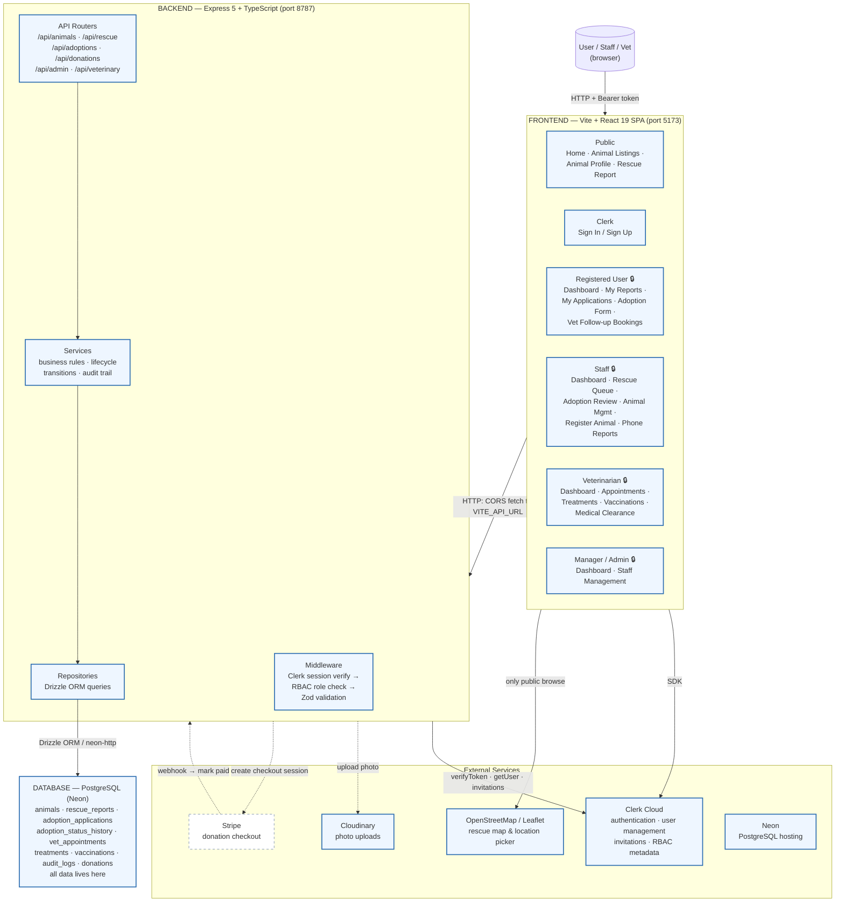

# ARA System Architecture

> Architecture diagram of the **completed** system. Solid lines/boxes = built and
> shipping. Dashed lines/boxes = planned to complete the system (Stripe hosted checkout and notifications).

## Legend

| Style | Meaning |
|---|---|
| Solid box / arrow | Built and functional |
| Dashed box / arrow | Planned for completion |
| `🔒` | Server-side RBAC enforced (Clerk `publicMetadata.role`) |

## System Architecture



## Layers

### Frontend — Vite + React 19 SPA (`src/`)

- **No URL router** — navigation is a `view` string in `App.tsx` state, threaded
  to pages as `onNavigate`. Pages: `src/components/` (shared) + `src/features/`
  (animals, rescue, adoptions, donations, veterinary).
- **API access** — `src/services/*Api.ts` call the Express API with `fetch()`
  and a Clerk Bearer token. Public endpoints (listings, rescue reports,
  donations) need no token.
- **Role gating** — header shows the right dashboard based on
  `user.publicMetadata.role`; the server is the real gate.

### Backend — Express 5 + TypeScript (`server/src/`)

Every module follows the same layered pattern:

```
routes.ts  →  service.ts  →  repository.ts
   ↑HTTP        ↑business       ↑Drizzle
   zod only     rules           queries
```

- Auth middleware verifies the Clerk Bearer token (`requireClerkSession`,
  `resolveOptionalClerkUserId`); RBAC checks roles (`requireStaffOrAbove`,
  `requireManagerOrAdmin`).
- `audit.service.ts` writes every sensitive action (dispatch, approval,
  status change) to `audit_logs`.

### Database — PostgreSQL on Neon (single source of truth)

All modules persist to one shared database via Drizzle ORM. Key data:

| Data | Table(s) |
|---|---|
| Animal profiles | `animals` (soft-delete via `deleted_at`) |
| Rescue reports | `rescue_reports` |
| Adoption applications | `adoption_applications` + `adoption_status_history` |
| Vet care | `vet_appointments`, `veterinary_care_plans`, `veterinary_treatment_history` |
| Audit trail | `audit_logs` |
| Donations | `donations` |

## External services

| Service | Used for | Status |
|---|---|---|
| Clerk | Auth, user management, role metadata, staff invitations | Built |
| Cloudinary | Animal / rescue photo uploads | Built |
| Neon | PostgreSQL hosting + pgvector animal search | Built |
| Gemini | Public-profile and full-query embeddings (768 dimensions) | Built |
| OpenStreetMap + Leaflet | Rescue location picker & map | Built |
| Stripe | Donation hosted checkout (`stripe_checkout_session_id` reserved) | Planned |

## Hybrid animal search

The public animal endpoint follows the existing route/service/repository layers.
A deterministic parser supplies explicit structured constraints while Gemini
embeds the full normalized query. Repository SQL applies the shared public
visibility rule and structured predicates, excludes NULL vectors, applies the
configured similarity threshold, orders by pgvector cosine distance, and limits
results. Ranked IDs select and order existing frontend cards; sidebar filters
narrow those results.

Normal listing and AI search both require status other than adopted, no deletion
timestamp, and medical clearance. Embeddings may exist for non-public animals.
Missing-vector retries run after eligible profile updates or successful medical
clearance, without blocking business operations when the provider fails.
See [backend documentation](server/README.md) for exact rules and configuration.
